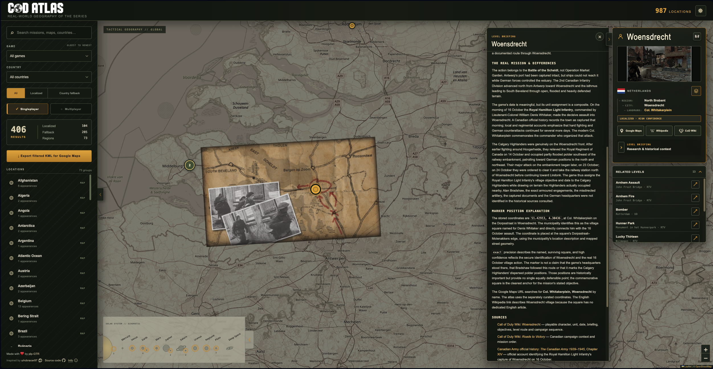

# CoD Atlas

CoD Atlas is an interactive map tracing the real-world geography portrayed
throughout the Call of Duty series. It connects campaign missions, multiplayer
maps, Zombies maps, and Other activities such as Special Ops, Survival, and Challenges with
the countries, regions, cities, landmarks, and historical sites they depict,
adapt, or draw inspiration from.

## Explore the geography of the series

Browse the map or search for a mission, map, country, or place. Filter by game,
geography, mode, or location accuracy, with game templates and advanced filters
for more specific selections. Share a filtered view or selected level through
its URL. Double-click a game to select it alone.

**Follow campaign** offers a guided map tour of a campaign's missions and
briefings. Select a game and campaign to find this option.

Each entry explains what the marker represents and distinguishes a well-sourced
location from an approximate, regional, or country-level fallback. Where
available, the details include historical context, research notes, source
links, related levels, images, and geographically aligned map overlays.

Filtered locations can also be exported as KML for use in Google Maps and
other compatible mapping tools. Settings without a terrestrial location are
kept in the atlas and presented separately instead of being assigned a
misleading point on Earth.

CoD Atlas is open and community-maintained. Locations are curated with
attention to source quality, geographic precision, and the difference between
a confirmed setting and a plausible real-world inspiration. Human verification
is recorded in each level's Markdown frontmatter, with reviewer credit and an
optional explanation.

The project is not production-ready yet. But you can have a first look on the
staging environment:

* Visit the page: https://cod-atlas.com/
* Staging (main branch): https://staging.cod-atlas.com/
* Test (develop nightly): *not yet*

## How AI is used

AI may assist with researching levels, comparing in-game settings with real
places and historical events, and drafting cited research notes. It is treated
as a research and editorial aid, not as an authority. 

Whenever AI is used to produce content, that content is explicitly marked at
the point where it appears. The disclosure is kept beside the affected text so
readers do not have to find a separate policy to understand how it was made.

Most marker locations are not yet recorded as verified by a human. Location
precision, research completion, and human verification are tracked separately.
See the
[human verification progress report](docs/progress.md#human-verification-progress)
for recorded coverage.

When the evidence supports only an approximate area, region, or country, the
atlas labels that precision explicitly.

## Documentation

Start with [CONTRIBUTING.md](CONTRIBUTING.md) for project setup, development,
data changes, validation, and the pull-request workflow.

Detailed references:

- [Research and geographic localization progress](docs/progress.md)
- [Atlas data model](docs/data-model.md)
- [Data contribution guide](docs/contributing-data.md)
- [Running npm commands through Docker](docs/docker-commands.md)
- [Wiki import command](docs/wiki-import.md)
- [AI instructions for level map research](docs/map-research-ai-instructions.md)
- [Level templates](docs/templates/)

## Licensing and attribution

See the [source-code license](LICENSE), [data license](LICENSE-DATA), and
[notices and attribution](NOTICE.md).

### Project status

CoD Atlas is an unofficial, non-commercial community project and is not
affiliated with, endorsed by, or sponsored by Activision or any other
relevant rights holder. The project is provided free of charge and is not
operated for commercial gain.

### Copyright and trademarks

Call of Duty and related game names, logos, imagery, artwork, screenshots,
textures, and other game assets are trademarks and/or copyrighted material
of their respective owners.

Third-party material included or referenced by the project remains subject
to the rights and terms of its respective owners and is not relicensed under
the CoD Atlas source-code or data licenses.

See [NOTICE.md](NOTICE.md) for detailed attribution and rights information.
